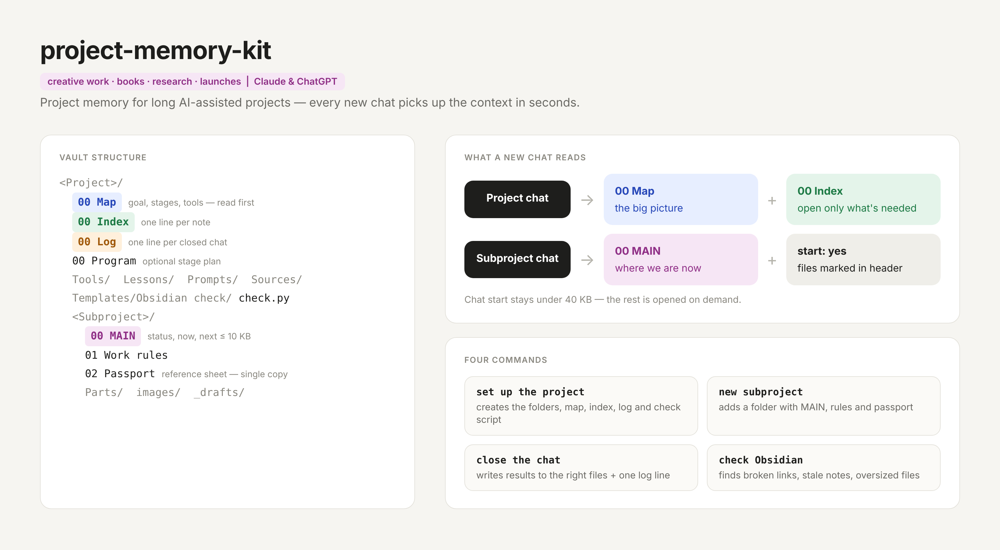

# project-memory-kit

**Project memory for long AI-assisted projects.** An AI skill for Claude and ChatGPT that keeps a long project in a small Obsidian structure, so every new chat picks up the context in seconds instead of re-reading everything.

I built it for my own creative work: brand identities, ad campaigns, video and animation. That's where it's been tested. But the problem it solves isn't creative, so it fits any project you run with an AI assistant for weeks:

- a book, a thesis or a long article
- research and studies
- a product or service launch
- learning a big course
- a consulting project with one client

## The problem

Long projects run for weeks: references, notes, decisions, approvals, versions. With an AI assistant they break down in two ways: one chat grows until it gets slow and forgetful, or you start a new chat and lose what was decided. project-memory-kit keeps the project's memory in your Obsidian vault, in a few small files that every new chat reads first.

## What it does

| Command | What happens |
|---|---|
| `set up the project` | Asks 3 questions, creates the folder skeleton, the map, index, log and a check script, and gives you text to paste into your project instructions. |
| `new subproject` | Adds a folder for a big piece of work (a video, a campaign, a book chapter) with `00 MAIN`, work rules and a passport (the reference sheet). |
| `close the chat` | Writes the chat's results to the right files, adds one line to the log, and gives you a phrase to start the next chat. |
| `check Obsidian` | Runs a read-only script that finds broken links, files missing from the index, oversized notes and stale dates, then checks the meaning. |

Commands work in any language — the assistant replies in yours.

## How it works

- **00 Map** — goal, stages, tools. Read first.
- **00 Index** — one line per note, so the assistant opens only what the task needs.
- **00 Log** — one line per closed chat: what was decided and where it's written.
- **00 MAIN** (per subproject) — current status, next steps, open questions. Kept under 10 KB.
- **02 Passport** (per subproject) — the reference sheet: style, characters and prompts for creative work, or whatever must stay consistent in your project.
- **One truth, one place** — each fact lives in exactly one file; everything else links to it.

A chat starts by reading under 40 KB. Everything else is opened on demand.

## Requirements

- An AI assistant that supports skills (the open SKILL.md format): Claude, ChatGPT, Claude Code or Codex.
- An Obsidian vault folder.
- Python 3 for the check script.

Works best when the assistant can read and write the vault folder directly: a folder connected through the Claude desktop app, or a local folder in Claude Code or Codex. In a chat without file access, the assistant gives you the files to download and tells you where to put each one.

## Install

**Claude (web and desktop app)**
1. Download `project-memory-kit.zip` from [Releases](../../releases).
2. Open **Customize → Skills**.
3. Click **+** → **Create skill** → **Upload a skill**, and choose the ZIP.
4. Make sure the skill is switched on.

**ChatGPT**
1. Download `project-memory-kit.zip` from [Releases](../../releases).
2. Open **Skills** → **Create** → **Upload from your computer**, and choose the ZIP.

**Claude Code / Codex**
Copy the `project-memory-kit` folder to `~/.claude/skills/` (Claude Code) or `~/.codex/skills/` (Codex).

## Quick start

1. Create an empty folder in your Obsidian vault and give the assistant access to it.
2. Write: `set up the project`.
3. Answer the three questions.
4. Paste the instructions text you get into your project's instructions (Claude Projects, ChatGPT Projects).
5. At the end of each working chat, write `close the chat`. Once a week, write `check Obsidian`.

## About the author

**[Dmitry Novohatskiy](https://www.linkedin.com/in/dm-novohatskiy/)** — Design Director with 15+ years in international creative agencies and in-house teams.

I build design functions as systems: processes, priorities, standards and a clear link to business goals. Now I bring the same systematic approach to AI in creative work: I build AI skills and workflows that take routine off the team and keep context between tasks. project-memory-kit is one of these tools. It grew out of a real long-running project where, without structure, chats quickly lost the thread.

LinkedIn: [linkedin.com/in/dm-novohatskiy](https://www.linkedin.com/in/dm-novohatskiy/)

If the skill helped you, star the repo ⭐ or message me on LinkedIn — I'd love to hear how you use it.

## License

MIT — see [LICENSE](LICENSE).
